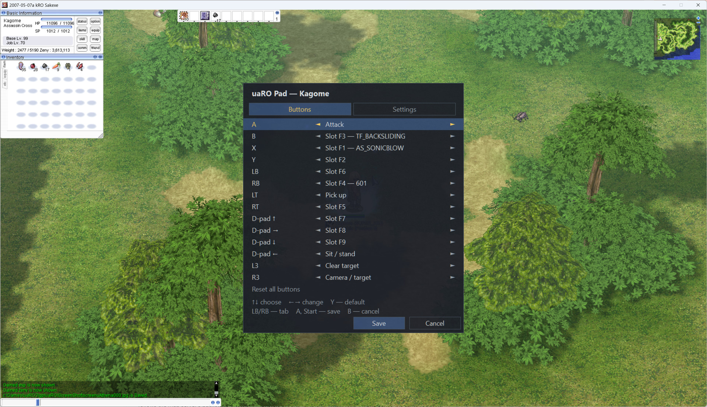

# Ragnarok Gamepad

**Play the classic Ragnarok Online client with an Xbox controller.** A drop-in `dinput.dll` for the
[uaRO](https://uaro.kiev.ua) client (`uaRO.exe`, a 2007 Sakexe, packet version 22): walk with the stick, fight
with the buttons, cast skills from the hotkey bar without touching the mouse — and keep the keyboard and mouse
working alongside. It also fixes the client's mouse and window: the cursor is never captured, follows the Windows
cursor exactly, and the window can go borderless.



*The Start menu over the game: each button with its action and what lies in the slot it uses (Assassin Cross,
Sonic Blow on X, Back Sliding on B).*

Player guides: **[English](dist/README.md)** · [Українська](dist/README.uk.md) · [Русский](dist/README.ru.md)

---

## Contents

- [What it can do](#what-it-can-do)
- [Quick start](#quick-start)
- [Controls](#controls)
- [The Start menu](#the-start-menu)
- [Settings reference](#settings-reference)
- [Compatibility](#compatibility)
- [How it works](#how-it-works)
- [Building from source](#building-from-source)
- [Project layout](#project-layout)
- [License](#license)

## What it can do

### Walking
- **The left stick walks** in any direction, 360°, relative to the screen — the camera's turn included.
- **Letting go stops the character on the spot.** The pad sends the stop a couple of cells ahead, where the
  server already is, so the character never steps back.
- **Walk radius** (how far ahead the pad "clicks") is a setting: short for tight spots, long for open fields.

### Fighting
- **A attacks the nearest monster** in a straight line, the way you see it on screen, up to 15 cells away.
  The attack goes on until the monster dies and resumes by itself after skills.
- **Hold A to farm:** when the target dies, the next nearest one is taken at once.
- **The right stick picks a monster** in the direction you push it. A monster you picked, or the one being
  fought, stays the target; anything else gives way to the nearest monster on the next press.
- **Smart give-ups:** a target that gets more than 15 cells away is dropped; one nobody can hit for 4 seconds
  (behind a wall, unreachable) is skipped for 10 seconds.
- **The mouse always wins:** a click with the real mouse takes over the fight from the pad.
- **Target mark only you see:** the client draws a state on the target for as long as it is the target — a
  poison tint (default), deadly poison, curse, stun stars, sleep, silence, Sight's fireball or Ruwach's light —
  or a "!" when it is chosen, or nothing.

### Skills and items
- **Any of 14 buttons can fire any of 27 hotkey bar slots** (F1–F9 of all three rows). The pad reads the bar
  straight from the client, so whatever you drag onto the bar with the mouse works on the pad too.
- **The pad aims every skill itself:**
  - enemy skills (Double Strafe, Sonic Blow…) go to the target, or the nearest monster, which becomes the target;
    out of range, the character walks up first;
  - ground skills (Arrow Shower, Storm Gust…) land on the target's cell;
  - hunter traps go two cells towards the target, where the server allows them;
  - buffs and heals go on yourself; Safety Wall, Pneuma, Warp Portal and Sanctuary under yourself.
- **Items** on the bar (potions, fly wings) are used the same way.
- **Held buttons repeat** (4 times a second by default) — spam a skill or drink potions while the button is down.
- **LT picks up** the nearest item; hold it to collect everything around, skipping what is not yours.
- **D-pad ←** sits down and stands up.

### Camera
- **R3 turns the right stick into a camera stick:** left / right turn the camera the way the right mouse button
  does (freely outdoors, 20° either way indoors, as the client allows); up / down zoom. R3 again — back to
  picking targets.
- **Directions follow the camera:** the pad reads the camera's turn from the client, so walking and aiming stay
  screen-relative after any turn, made with the stick or the mouse.

### The in-game menu
- **Start opens a menu over the game.** It never takes the focus: the game keeps running, the character
  stands still while it is open. The pad drives it; the mouse can click it.
- **Buttons tab:** any action on any of the 14 buttons, with the slot contents shown next to them.
- **Settings tab:** language, walk radius, target mark, vibration and the mouse and window options below.
- **One layout per character**, picked up automatically when you enter the game.
- **English, Ukrainian and Russian**, switched in the menu itself.

### Mouse and window (for keyboard-and-mouse players too)
- **Mouse freedom:** the client's mouse is never captured; the game cursor follows the Windows cursor exactly,
  also when the picture is stretched over a bigger window.
- **Clicks and the wheel reach the game only over its window:** scrolling a browser on a second monitor no
  longer zooms the camera; a click on the title bar no longer sends the character walking.
- **Normal Windows cursors over the title bar and the borders** (the client used to hide them).
- **Optional cursor lock** inside the game window; Alt+Tab and the Win key release it.
- **The click that brings the window back** only activates it — handy with two clients.
- **Middle and side mouse buttons can press F1–F9.**
- **Borderless window**, centred on its monitor, left in place, or at a given position.
- **CPU saving:** the client stops spinning a whole CPU core while it is in the background.

### Safe by design
- **Fail-open:** any internal error switches the pad to pass-through; the client keeps working.
- **No server changes:** the pad sends the requests the client itself would send.
- **Build check:** client memory (hotkey bar, cursor, camera) is used only after the code at those addresses has
  been compared byte for byte; another client build simply goes without those features.
- **Back switches the pad off and on** at any moment.
- **A readable log** (`uaro-pad.log`) says what the pad saw and decided: which monster it took and why, why a
  slot was refused, which settings were saved.

## Quick start

1. Close the client.
2. Copy `dinput.dll` and `uaro-pad.ini` next to `uaRO.exe`. If a `dinput.dll` is already there (ROExt),
   replace it.
3. Plug in an Xbox controller (or any controller Windows sees as XInput) and start the client.
4. Press **Start** to choose the language and set up the buttons.

To remove the pad, delete `dinput.dll`, `uaro-pad.ini` and `uaro-pad-binds.ini`; the client itself is never
changed.

## Controls

The default layout, every button can be reassigned in the menu:

| Button | Action |
|---|---|
| Left stick | walk |
| Right stick | pick a monster in that direction (camera mode: turn and zoom) |
| A | attack the nearest monster; hold to go on to the next |
| X, Y, B | hotkey slots F1, F2, F3 |
| RB, RT | slots F4, F5 |
| LB | slot F6 |
| D-pad ↑ → ↓ | slots F7, F8, F9 |
| LT | pick up items |
| D-pad ← | sit / stand |
| L3 | clear the target |
| R3 | right stick: targets ↔ camera |
| Start | the menu |
| Back | pad off / on |

## The Start menu

| | Gamepad | Mouse |
|---|---|---|
| Switch tab | LB / RB | click the tab |
| Pick a row | ↑ ↓ or the left stick | click the row |
| Change it | ← → (held: repeats) | click ◄ / ► |
| Back to the default | Y (the row), A on the last row (the whole tab) | click the last row |
| Save and close | A or Start | Save |
| Close without saving | B | Cancel |

Button layouts go to `uaro-pad-binds.ini` (per character), settings to `uaro-pad.ini` — only the keys you
changed; comments and everything else in the file stay as they were.

## Settings reference

The main keys of `uaro-pad.ini` (the file explains every one; most are also in the Settings tab):

| Key | Default | What it does |
|---|---|---|
| `[general] language` | `en` | menu language: `en`, `uk`, `ru` |
| `[general] enabled` | `1` | `0`: the pad starts switched off (Back switches it on) |
| `[stick] walk_radius` | `0.22` | how far ahead walking clicks, a share of the window's shorter side |
| `[stick] deadzone` | `0.25` | left stick dead zone |
| `[mouse] freedom` | `1` | the mouse is not captured; the game cursor follows the Windows cursor |
| `[mouse] lock` | `0` | keep the cursor inside the game window |
| `[mouse] focus_click` | `0` | `1`: the click that activates the window also acts in the game |
| `[mouse] middle`, `button4`, `button5` | `none` | `F1`…`F9` for the middle and side mouse buttons |
| `[window] borderless` | `0` | no title bar and borders |
| `[window] position` | `center` | borderless window: `center`, `keep` or `X,Y` |
| `[window] background_sleep_ms` | `10` | sleep per frame while the game is in the background (`0`: never) |
| `[aim] mark` | `poison` | target mark: `poison`, `dpoison`, `curse`, `stun`, `sleep`, `silence`, `sight`, `ruwach`, `gasp`, `off` |
| `[skills] repeat_ms` | `250` | repeat of a held slot button (`0`: no repeat) |
| `[skills] ground_self` | `12,25,27,70` | ground skills cast under yourself |
| `[skills] traps` | hunter traps | skills placed two cells towards the target |
| `[target] give_up_seconds` | `4` | drop a target nobody can hit for this long |
| `[rumble] enabled` | `1` | controller vibration |

## Compatibility

- **Client:** `uaRO.exe` / `uaRO-1.1.exe` (2007 Sakexe, packet version 22), windowed or full screen
  (dgVoodoo). The hotkey bar, the exact cursor and the camera need this exact build. On another build the pad
  still walks, fights and picks up, the mouse is still free; slot buttons then work only if the server sends
  the hotkey bar (`0x02b9`), and the log says which features are off.
- **Server:** uAthena (an eAthena fork), `PACKETVER` 7. Other eAthena-family servers of that era may work.
- **System:** Windows with an XInput controller (Xbox 360 / One / Series or compatible); the DLL is 32-bit,
  like the client.

## How it works

```
uaRO.exe ──► dinput.dll (this project) ──► system dinput.dll
               │
               ├─ XInput ............. reads the controller
               ├─ DirectInput mouse .. mouse freedom, the virtual click for walking, the camera wheel
               ├─ recv / send ........ follows the map server's packets, sends walk / attack / skill requests
               ├─ client memory ...... hotkey bar, game cursor, camera (after a code check)
               └─ GDI window ......... the Start menu over the game
```

- The portable core (`src/core`) knows the protocol, keeps a model of the world around the character (monsters,
  items, skills, the hotkey bar) and turns the controller into requests; it has no Windows headers and is unit
  tested.
- The Windows layer (`src/win`) hooks the client's DirectInput, `recv` / `send`, `PeekMessageA` and the window,
  and draws the menu.
- Packet layouts come from the uAthena sources (`tools/gen_packet_tables.py`); client internals were found in a
  decompilation of the client and are checked against its code at start-up.

## Building from source

On Linux with CMake and MinGW-w64 (i686):

```sh
cmake -S . -B build-win -DCMAKE_TOOLCHAIN_FILE=cmake/mingw-i686.cmake -DCMAKE_BUILD_TYPE=Release
cmake --build build-win            # build-win/dinput.dll
tools/check_dll.sh build-win/dinput.dll
tools/package.sh                   # dist/out/uaro-pad-<version>.zip: the DLL, uaro-pad.ini and the guides
```

Host tests for the core:

```sh
cmake -S . -B build-host && cmake --build build-host && build-host/uapad_tests
```

## Project layout

| Path | What is there |
|---|---|
| `src/core` | protocol, world model, controller, targeting, menu and settings logic, translations (no Windows) |
| `src/win` | the DLL: hooks, DirectInput wrappers, XInput, client memory, the menu window, the game window |
| `tests` | unit tests of the core |
| `tools` | packet table generator, DLL import check, packaging |
| `dist` | what players get: `uaro-pad.ini` and the guides in three languages |
| `docs` | design notes and images |

## License

MIT, see [LICENSE](LICENSE).
